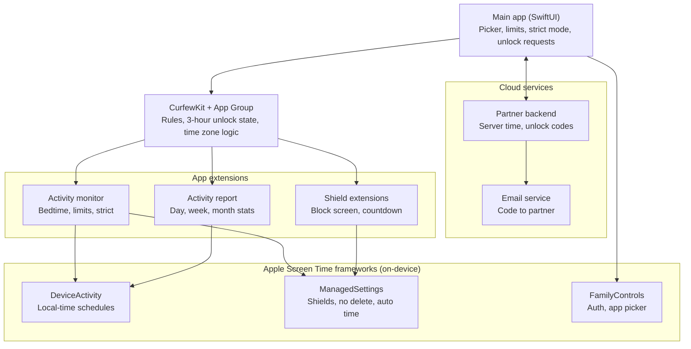
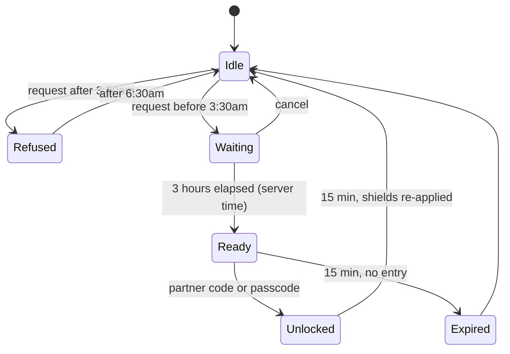

# Phone Curfew

A strict iOS screen-time app that limits iPhone use during the day and blocks apps entirely at bedtime (10:30pm to 6:30am, local time). Early unlocks require a 3-hour wait plus a code sent to an accountability partner (or the device passcode), and nothing unlocks within 3 hours of wake time. Daily, weekly and monthly usage statistics are shown in-app.

Built on Apple's Screen Time API: FamilyControls, ManagedSettings and DeviceActivity. Requires iOS 17+ and a real device (the Screen Time API does not work in the Simulator).

---

## Architecture

The project has five targets (one app, four extensions) plus a shared Swift package and a small backend:

| Layer | Component | Runs where | Responsibility |
| --- | --- | --- | --- |
| App | Main app (SwiftUI) | iPhone, foreground | Setup, app picker, limits, strict mode, unlock requests, stats screen |
| Shared | CurfewKit + App Group | iPhone, all targets | Models, persisted rules, unlock state machine, time zone logic |
| Extension | DeviceActivityMonitor | iPhone, background | Applies and lifts shields at schedule start/end and when limits are hit |
| Extension | ShieldConfiguration + ShieldAction | iPhone, on shield display | Custom "Go to sleep" block screen and button behavior |
| Extension | DeviceActivityReport | iPhone, sandboxed | Renders daily, weekly and monthly usage statistics |
| Cloud | Partner backend | Server (e.g. Cloudflare Worker) | Trusted time, partner registry, unlock codes |
| Cloud | Email service | Third party (e.g. Resend, SendGrid) | Delivers invites and unlock codes to the partner |

---

## Components

### Main app (SwiftUI)

The only target the user interacts with directly.

- **Onboarding.** Requests Screen Time permission with `AuthorizationCenter.shared.requestAuthorization(for: .individual)` and handles denied or revoked states.
- **App picker.** Uses `FamilyActivityPicker` to build two selections:
  - `bedtimeBlocked`: apps blocked from 10:30pm to 6:30am, or "block everything except an allowlist" (Phone, Messages, Alarm).
  - `daytimeLimited`: apps with a daily time budget.
  
  The picker returns opaque tokens, not bundle IDs. Display them with `Label(token)`.
- **Limits and schedule.** Bedtime (default 22:30), wake time (default 06:30) and per-app daily budgets.
- **Strict mode.** Turns on delete protection and forced automatic time. Settings that loosen rules wait 24 hours, and settings are read-only during bedtime.
- **Partner setup.** Manages the "My emails" list and the accountability partner.
- **Unlock requests.** Starts the 3-hour wait and shows the countdown. Completes the unlock with the partner code or the device passcode.
- **Stats tab.** Embeds `DeviceActivityReport` with Day, Week and Month filters.
- **Fallback enforcement.** If the app opens during bedtime and the shield isn't active, it re-applies it, because DeviceActivity callbacks can occasionally fire late.

### CurfewKit + App Group

A local Swift package linked into every target. It shares state through the App Group container `group.com.<you>.phonecurfew`.

- **Models and storage.** Encoded `FamilyActivitySelection`s, schedules, limits, strict flag, partner status, and dated shield-hit counters.
- **Unlock state machine.** `idle → waiting (3h) → ready (15 min) → unlocked (15 min) → idle`, plus `expired` and `refused`.
- **Time zone logic.** Every wall-clock comparison (10:30pm, 3:30am, 6:30am) goes through one helper that uses `TimeZone.current` and `Calendar.current`, fetched fresh each call.
- **Email normalization.** `normalizeEmail()` lowercases, strips `+tags`, removes Gmail dots and maps googlemail.com to gmail.com.

Extensions have tight memory limits, so CurfewKit stays dependency-free.

### Activity monitor extension (DeviceActivityMonitor)

Runs in the background whenever a schedule boundary or usage threshold is reached, even if the app isn't open. It uses separate named `ManagedSettingsStore`s so each rule can be lifted independently:

| Store | Set when | Cleared when |
| --- | --- | --- |
| `.bedtime` | `intervalDidStart` of the bedtime schedule (22:30) | `intervalDidEnd` (06:30), or temporarily after a verified unlock |
| `.daytime` | `eventDidReachThreshold` for a limited app | End of the daytime interval |
| `.strict` | Strict mode turned on | Strict mode turned off, after the 24-hour cooling-off |

For "block everything" mode, the bedtime store uses `.all(except: allowlist)`.

### Shield extensions (ShieldConfiguration + ShieldAction)

- **ShieldConfigurationDataSource.** Draws the block screen. During bedtime it shows "It's past 10:30 — go to sleep" and the time until 6:30am. If an unlock is pending, it shows the remaining wait. During the day it shows the budget-used message.
- **ShieldActionDelegate.** The primary button closes the app. In strict mode there is no "ignore limit" button. Each shield display and tap increments a dated counter, which appears on the stats screen as blocked attempts.

### Activity report extension (DeviceActivityReport)

Renders statistics with Swift Charts from `DeviceActivityResults`.

| View | Filter | Shows |
| --- | --- | --- |
| Day | `.hourly(during: today)` | Total time, per-hour breakdown, top apps, pickups |
| Week | `.daily(during: last 7 days)` | Daily totals, top apps, trend |
| Month | `.daily(during: last 30 days)` | Daily totals, weekly averages, top apps |

Apple keeps usage data inside this extension's sandbox. It can draw on screen, but it cannot send data to the main app, a file or a server.

### Apple Screen Time frameworks

- **FamilyControls.** Authorization (`.individual`) and `FamilyActivityPicker`.
- **DeviceActivity.** `DeviceActivitySchedule` for bedtime and daytime windows, `DeviceActivityEvent` for usage thresholds, and the report extension API. Schedules use `DateComponents` with no `timeZone`, so they follow the phone's local time.
- **ManagedSettings.** Shields for apps, categories and web domains. Also `application.denyAppRemoval` and `dateAndTime.requireAutomaticDateAndTime`.

### Partner backend

A small serverless API. iOS apps can't send email silently, so this is required for partner unlock.

| Endpoint | Purpose |
| --- | --- |
| `POST /emails` | Register the user's own addresses (normalized) |
| `POST /partner/invite` | Validate a partner address and email them an invite link |
| `GET /partner/confirm` | Partner accepts; their 7-day waiting period starts |
| `POST /unlock/request` | Validate against the 3:30am cutoff and start the 3-hour wait (server-timestamped) |
| `POST /unlock/code` | After 3 hours, generate the code and email it to the partner |
| `POST /unlock/verify` | Check the code: hashed, 10-minute expiry, 3 attempts |
| `GET /time` | Trusted current instant (UTC) |

It stores the normalized email list, partner status and dates, hashed codes, and an unlock log for the partner's weekly summary.

### Email service

A transactional email provider such as Resend or SendGrid. It sends partner invites, unlock codes (with the user's reason and time), partner-change notices to the current partner, and the weekly unlock summary.

---

## Key flows

### Bedtime lock

1. At 22:30 local time, DeviceActivity calls the monitor's `intervalDidStart`.
2. The monitor reads `bedtimeBlocked` from the App Group and applies the `.bedtime` shields.
3. Opening a blocked app shows the custom shield.
4. At 06:30 local time, `intervalDidEnd` clears `.bedtime`.

### Early unlock (3-hour wait)

| Request at | Earliest unlock |
| --- | --- |
| 10:30pm | 1:30am |
| 1:00am | 4:00am |
| 3:30am | 6:30am |
| After 3:30am | Refused until 6:30am |

- **Partner route.** The code is emailed only when the wait ends, so it can't arrive early.
- **Passcode route.** Uses `LAContext` with `.deviceOwnerAuthentication`, available only in the Ready state.

### Partner verification

The app can't prove an address isn't the user's, so these checks make cheating slow and visible instead:

| Check | Catches |
| --- | --- |
| Normalized match against "My emails" | `you+x@gmail.com`, `y.o.u@gmail.com` |
| Block the whole domain if the user owns a custom domain (public providers like gmail.com are exempt) | A second inbox on your own domain |
| Block disposable-email domains | Throwaway inboxes |
| Partner must click the invite link; new partners wait 7 days before approving | Addresses you control but don't check |
| Adding, changing or removing a partner takes 7 days and emails the current partner | Swapping in a fresh Gmail at 11pm |
| Codes: 10-minute expiry, 3 tries, weekly cap; weekly summary to the partner | Brute force, quiet repeated unlocks |

---

## Time handling

- **Wall-clock rules follow the phone.** Bedtime, the 3:30am cutoff and wake time are stored as hour and minute only, and always evaluated in `TimeZone.current`. They move with travel and daylight saving.
- **"Now" comes from the server.** The backend's UTC instant is converted into the phone's zone before any comparison, so changing the device clock doesn't help.
- **The wait is elapsed time.** The 3-hour wait is measured in real hours, even if the time zone changes mid-wait. Only the cutoff and wake time shift to the new zone.
- **Monitoring restarts on change.** On `NSSystemTimeZoneDidChange` and `significantTimeChangeNotification`, the app restarts DeviceActivity monitoring and recomputes any pending unlock.
- **Zones can't be faked.** Strict mode's `requireAutomaticDateAndTime` keeps the zone set from the phone's real location.

---

## Known limits

- **Settings and emergency calls** can't be shielded.
- **Permission revocation.** If you know the device's Screen Time passcode, you can revoke the app's permission in Settings. Close this by having your partner set and keep that passcode, and turning on Lock Screen Time Settings.
- **Callbacks can be late.** DeviceActivity callbacks occasionally fire late; the main app's fallback re-applies shields.
- **Usage data can't be exported.** It stays inside the report extension.
- **Privacy label.** Partner unlock means the app collects contact info (email addresses), so the App Store privacy label is not "Data Not Collected".

---

## Requirements and distribution

- Xcode (latest), iOS 17+, a physical iPhone with Developer Mode on.
- Apple Developer Program membership.
- Capabilities on every target: Family Controls and App Groups.
- **Family Controls (Distribution) entitlement.** Needed for TestFlight and the App Store, and requested separately per bundle ID at [developer.apple.com/contact/request/family-controls-distribution](https://developer.apple.com/contact/request/family-controls-distribution). Request it early; approval has been taking several weeks.
- The project is defined with XcodeGen (`project.yml`). Run `xcodegen generate` after changing targets.
